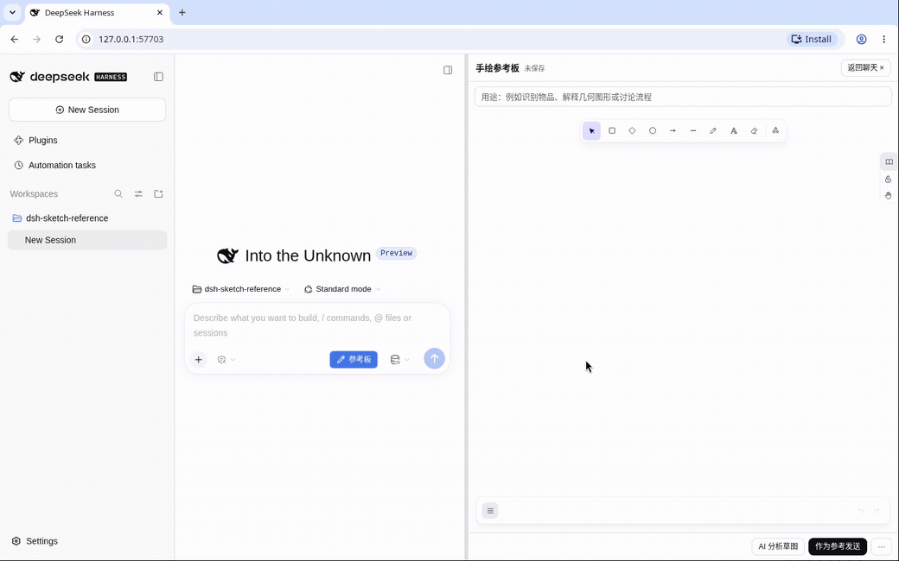

<div align="center">

# DSH Sketch Reference

### Keep the sketch in your session. Let DSH keep building.

[](https://github.com/Amadeus2027/dsh-sketch-reference/releases/latest) [](https://github.com/Amadeus2027/dsh-sketch-reference/actions/workflows/ci.yml) [](LICENSE) [](https://github.com/deepseek-ai/deepseek-harness)

[**Download**](https://github.com/Amadeus2027/dsh-sketch-reference/releases/latest) · [**Quick start**](#quick-start) · [**中文**](README.md) · [**DeepWiki**](https://deepwiki.com/Amadeus2027/dsh-sketch-reference)

</div>

**Draw three boxes instead of describing every layout detail.** Sketch Reference brings Excalidraw into DeepSeek Harness. The native Agent can read your sketch on demand, anchor comments to shapes and propose canvas edits for your approval.



*Continuous screen capture with the system cursor, native drawing, edits and save waits. Automated inputs; no model calls or fabricated answers. [Still image](docs/assets/v0.6.5/sketch.png) · [Provenance](docs/assets/v0.6.5/README.md)*

A human-operated, real DeepSeek multi-turn development video is pending Windows recording. Existing real website and PPT cases are linked below. Normal DSH chat retains its command and file tools; the plugin does not restrict the Agent to canvas analysis.

## Before and after adding the plugin

The same task: **“Build from this layout, then change this part.”**

| Native chat + an ordinary PNG | With Sketch Reference |
| --- | --- |
| **Express the layout:** describe it, or draw elsewhere and upload | **Draw in the session:** autosave alongside the current task |
| **Discuss one area:** describe “the box on the right” or mark another image | **Point to shapes:** anchored comments, navigation and follow-up menus |
| **Update the reference:** edit the original, export and attach again | **Read on demand:** Agent gets the current saved structure and PNG |
| **Edit the canvas:** adjust it manually in a drawing tool | **Preview and approve:** Agent proposes → you preview → approve → native undo |

DSH already supports image understanding and workspace tools. This compares **communication and editing workflows**, not model quality, latency or token consumption.

## One sketch, three ways to collaborate

- **Draw and ask.** Use native chat: “Build a webpage from the current sketch.” Standalone AI analysis is optional.
- **Point and discuss.** Ask the Agent to annotate an area. Follow-up, correction and edit actions draft a message in the native composer; you edit and send it.
- **Preview and approve.** Restricted tools propose canvas changes with aligned before/after previews. Stale proposals cannot overwrite a newer sketch.

Drawings and comments are session-bound. Drawing, hovering and paging do not call a model. No extra AI service or separate key configuration is introduced.

<details>
<summary>Historical comment menu (v0.6.3)</summary>


An actual screenshot of the installed release. Comment text comes from a fixed test response to demonstrate interaction; it is not a new real DeepSeek result.

</details>

## What you can build with it

| Use case | Keep iterating in the same conversation |
| --- | --- |
| Web / UI | Sketch → implement → correct search, navigation and return behavior. [Dashboard and three-screen UI](docs/release-readiness-v0.6.0.md#b-真实应用与纠正) |
| Slides | Sketch regions → create editable slides → adjust a specific page. [Five-page PPTX and focused correction](docs/release-readiness-v0.6.0.md#b-真实应用与纠正) |
| Freehand | Draw an object or diagram → discuss the image → clarify. [Unlabeled cup and collaboration](docs/windows-validation-v0.4.0-20261010.md) |

**DSH Agent** creates the webpages, UI and slides; the plugin supplies editable visual context. Older UI in these reports remains historical evidence. Individual examples do not guarantee results for every drawing.

## Quick start

**DSH already installed? No separate Excalidraw installation.** The package includes the editor, its React drawing runtime and fonts; DSH’s official manager installs declared host dependencies.

Download the versioned `.tgz` and its matching `SHA256SUMS.txt`, save your work and exit the host, then run:

```sh
dsh plugin --profile web add /absolute/path/dsh-sketch-reference-0.6.5.tgz
```

Restart with `dsh web`. No repository clone, separate Excalidraw install or user-side build. Before v0.6.5 is published, obtain the candidate from [CI artifacts](https://github.com/Amadeus2027/dsh-sketch-reference/actions/workflows/ci.yml); published packages live in [Releases](https://github.com/Amadeus2027/dsh-sketch-reference/releases/latest). A source ZIP is not an installable plugin.

Supports DSH Web `0.2.1-alpha.1` / `0.2.1-alpha.2`. Keep your profile, storage and browser data; no drawing migration or version exemption. The npm CLI host’s manager itself requires pnpm; that is a host prerequisite, not a separate Excalidraw requirement. See the [installation guide](docs/installation.md).

1. Choose a workspace and session, click **参考板** beside the composer, then draw and add a purpose.
2. Wait for **已保存** and return to native chat. **作为参考发送** optionally adds the PNG to the composer.
3. Discuss, annotate or request a change. Review and approve canvas edits; send chat messages yourself.

The UI is Chinese. Configure models and authentication inside DSH; image reads need image input support. Without a model, drawing, saving and exports still work. See the [usage guide (Chinese)](docs/usage.md).

<details>
<summary>Compatibility, data and feature boundaries</summary>

- v0.6.5 functional checks cover both Web hosts on isolated Linux installations; Windows and real models remain pending. Other host versions, mobile clients, non-default tool modes and every plugin combination are not claimed compatible.
- Uncertain anchors fall back to text. Models may misread sketches or return invalid arguments; mathematical correctness is not guaranteed. Focus is version-bound and does not restrict other host tools or erase chat history.
- Canvas edits are allowlisted; arbitrary changes to locked, bound, grouped elements or styles are unsupported. Undo history is not restored across refreshes.
- Drafts/images live in local DSH storage; model-visible data goes to the configured provider. Historical attachments are not automatically reclaimed. Export backups before upgrading or uninstalling.
- After a synchronization disconnect, use **⋯ → 同步批注** or reopen. There is no bundled website/PPT generator or automatic drawing-to-code synchronization.

[Host compatibility report](docs/dsh-compatibility.md) · [v0.6.5 validation scope](docs/validation-v0.6.5.md)

</details>

## Help improve visual collaboration

**Star the repository** to follow updates if you want DSH to keep working with the same sketch. [Share issues and use cases](https://github.com/Amadeus2027/dsh-sketch-reference/issues) with sanitized drawings and reproducible steps. Never upload keys, login links or private conversations.

<details>
<summary>Build, validation and licenses</summary>

```sh
pnpm install --frozen-lockfile
pnpm run typecheck
pnpm test
pnpm run bundle
pnpm pack
```

[Contributing](CONTRIBUTING.md) · [v0.6.5 validation](docs/validation-v0.6.5.md) · [Reuse](REUSE.md) · [Third-party notices](THIRD_PARTY_NOTICES.md)

[MIT](LICENSE). Drawing is provided by Excalidraw and host capabilities by DeepSeek Harness. This is a community plugin. Third-party licenses remain applicable; real-model evidence and scripted protocol tests are recorded separately.

</details>
