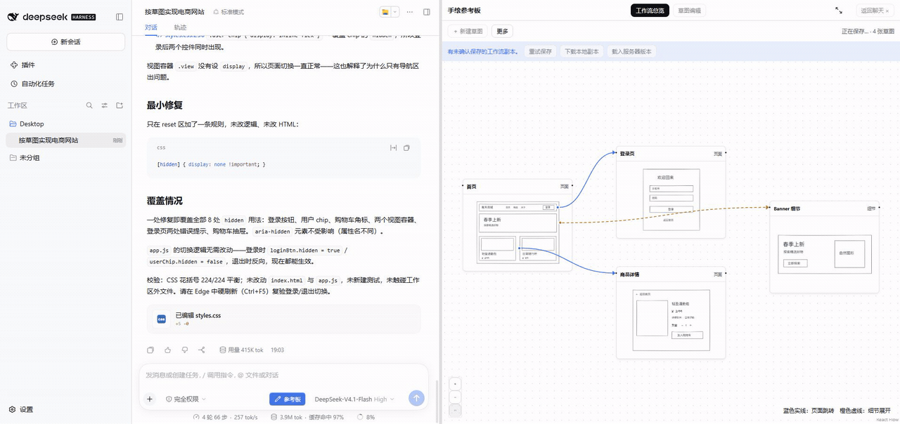
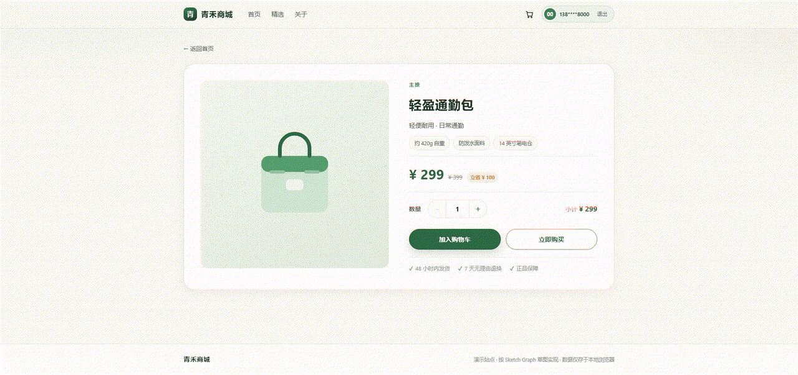

<div align="center">

# DSH Sketch Reference

### 画出想法，交给 DSH

[](https://github.com/Amadeus2027/dsh-sketch-reference/releases/latest) [](https://github.com/Amadeus2027/dsh-sketch-reference/actions/workflows/ci.yml) [](LICENSE) [](https://github.com/deepseek-ai/deepseek-harness) [](https://deepwiki.com/Amadeus2027/dsh-sketch-reference)

[**下载插件**](https://github.com/Amadeus2027/dsh-sketch-reference/releases/latest) · [**快速开始**](#快速开始) · [**使用指南**](docs/usage.md) · [**English**](https://github.com/Amadeus2027/dsh-sketch-reference/blob/main/README.en.md)

</div>

**画布局、讨论细节、在工作区实现。** Sketch Reference 把 Excalidraw 接入 DeepSeek Harness，让 Agent 按需读取草图、定位批注、提出修改；画板修改先预览，再由你确认。

**开发预览 v0.7.0-alpha.1：Sketch Graph。** 一张草图一个节点，从元素或框选区域连接页面与细节设计；保留右侧画板，新增全屏与可拖动的原生悬浮对话。旧草图继续作为根节点，无需覆盖迁移。[功能与验证边界](docs/release-v0.7.0.md)



*总览看关系，双击画细节。关联工具按需展开，备份收进更多菜单。[素材来源与剪辑说明](docs/assets/v0.7.0/README.md)*

<details>
<summary>真实 DeepSeek 对话生成的电商网页</summary>



Windows DSH alpha.2 原生聊天使用 DeepSeek-V4.1-Flash / High，读取 4 张草图及页面／细节关系，生成 HTML/CSS/JS，再经真实对话纠正与浏览器复验。GIF 展示最终网页的自动化操作，已剪去等待；不是完整生成过程录像，也不代表一次生成即可完成。[完整验收与失败记录](docs/validation-v0.7.0.md)

</details>

**稳定版 v0.6.5** 支持 DSH Web `0.2.1-alpha.1` / `0.2.1-alpha.2`。Windows alpha.2 实机回归与旧数据升级核对见 [验收记录](docs/windows-validation-v0.6.5.md)。


*画草图 → 调整布局 → 加入参考 → 回到聊天。[查看静态图](docs/assets/v0.6.5/sketch.png)*

<details>
<summary>演示与案例说明</summary>

画板演示为 v0.6.5 连续录屏，输入由自动化驱动，展示绘画、保存、PNG 附件与返回聊天；未调用模型或发送聊天消息。[录制来源与参数](docs/assets/v0.6.5/README.md)

网页、UI 与 PPT 案例来自各自记录中的真实 DSH Agent 实验，版本和运行结果见案例链接。完整真人／真实 DeepSeek 多轮开发录像仍待 Windows 录制。[录制清单](docs/demo-recording-v0.6.5.md)

下表比较草图沟通与编辑流程；模型质量、速度和 Token 消耗未作对照测量。

</details>

## 使用前与使用后

对比同一个任务：**“按这个布局做页面，接着调整这里。”**

| 仅原生聊天＋普通 PNG | 加上 Sketch Reference |
| --- | --- |
| **表达布局**：写文字，或在其他工具画图后上传 | **会话内画图**：草图自动保存，和当前任务放在一起 |
| **讨论局部**：说明“右边那个框”，或另做标记图 | **点选定位**：元素批注绑定真实图形，菜单追问或纠正 |
| **更新参考**：修改原图，再导出、附上新版 | **按需读取**：Agent 获取当前保存版本的结构与 PNG |
| **修改画板**：在绘图工具中手动调整 | **预览确认**：Agent 提议 → 前后预览 → 你确认 → 原生撤销 |

草图表达、局部讨论和修改确认，接在 DSH 的原生聊天与工作区工具上。

## 一张草图，三种协作方式

- **画好就问。** 直接在原生聊天说：“按当前草图实现一个网页。”无需先做独立 AI 分析。
- **指着位置继续聊。** 让 Agent 标注某个区域，从批注菜单「追问 / 纠正 / 修改这里」起草下一条消息；你编辑后自行发送。
- **看过再改。** Agent 通过受限工具提出画板修改，同视角预览后确认应用。旧版本提议不能覆盖新草图。

草图与批注按会话保存。绘图、悬停、翻页不会触发模型；没有额外 AI 服务或独立密钥配置。

<details>
<summary>批注与追问菜单</summary>


v0.6.3 菜单示例，批注为演示用固定样例。[素材说明](docs/assets/v0.6.3/README.md)

</details>

## 你可以拿它做什么

| 场景 | 在同一会话继续做 |
| --- | --- |
| 网页 / UI | 画布局 → 实现页面 → 围绕搜索、导航与返回行为纠正。[运营看板与三屏 UI](docs/release-readiness-v0.6.0.md#b-真实应用与纠正) |
| PPT | 画出分区关系 → 制作可编辑幻灯片 → 调整指定页布局。[5 页 PPTX 与局部纠正](docs/release-readiness-v0.6.0.md#b-真实应用与纠正) |
| 手绘 | 画物品或示意图 → 读图讨论 → 补充说明。[无文字杯子草图与协作闭环](docs/windows-validation-v0.4.0-20261010.md) |

插件提供可持续编辑的草图与参考图，**DSH Agent** 在工作区继续完成网页、UI 和 PPT。

## 快速开始

**源码 ZIP 和预构建包两种方式都支持。** 都通过 DSH 官方管理器加入插件，无需提前单独安装 Excalidraw。

选择版本：当前 `main`／源码 ZIP 和对应 CI 包是 **v0.7.0-alpha.1 开发预览**；`releases/latest` 目前提供 **v0.6.5 稳定版**，不包含 Sketch Graph。

### 1. 安装插件

**方式一：源码 ZIP 解压后加入 DSH**

点击 **[Code → Download ZIP](https://github.com/Amadeus2027/dsh-sketch-reference/archive/refs/heads/main.zip)**，解压后进入包含 `package.json` 的项目目录。先安装依赖并构建，再把这个目录加入 DSH；无需先生成 `.tgz`：

```sh
pnpm install --frozen-lockfile
pnpm run bundle
# 等待草图保存并退出正在运行的 DSH，然后加入解压后的项目目录
dsh plugin --profile web add "/绝对路径/dsh-sketch-reference-main"
dsh web
```

此方式会链接源码目录，请保留该目录及其中的 `lib`、`node_modules`。更新源码后重新构建并重启 DSH；换到新目录时重新执行 `add`。Windows 路径示例及升级说明见 [安装指南](docs/installation.md#从源码-zip-目录直接安装)。

**方式二：预构建安装包（无需本地构建）**

- **ZIP 下载**：进入 [成功的构建记录](https://github.com/Amadeus2027/dsh-sketch-reference/actions/workflows/ci.yml)，下载页面底部的 `dsh-sketch-reference-installable` ZIP，解压得到 `.tgz` 和 `SHA256SUMS.txt`。
- **直接下载**：从 [正式发行](https://github.com/Amadeus2027/dsh-sketch-reference/releases/latest) 获取对应版本的 `.tgz` 和校验清单。

取得对应版本的 `.tgz` 和同包 `SHA256SUMS.txt` 后，等待草图保存并退出宿主，然后执行：

```sh
dsh plugin --profile web add /绝对路径/dsh-sketch-reference-0.6.5.tgz
```

运行 `dsh web` 即可使用。预构建包已包含编辑器和字体，无需克隆源码、另装 Excalidraw 或手动构建。

环境：DSH Web `0.2.1-alpha.1` / `0.2.1-alpha.2`，npm CLI 管理器可调用 pnpm。升级保留原 profile、存储与浏览器数据。[安装与升级指南](docs/installation.md)

### 2. 从一张简单草图开始

1. 选择工作区并创建会话，点击输入框旁的 **「参考板」**，画图并添加用途。
2. 等待 **「已保存」**，返回原生聊天提问；也可点 **「作为参考发送」** 将 PNG 加入输入框。
3. 接着讨论、添加批注或请求修改。画板修改检查预览后确认，聊天消息由你发送。

模型与认证沿用 DSH 配置，图片读取需模型支持视觉输入。绘图、保存和导出可独立使用。[使用指南](docs/usage.md)

<details>
<summary>兼容性、数据与功能边界</summary>

- v0.6.5 两版 Web 宿主已完成 Linux 隔离回归，Windows alpha.2 完成安装、批注／编辑闭环、主题、分栏和 alpha.1＋0.6.3 旧数据升级核对。Agent 自动回归使用固定响应，未新增真实模型质量验证。其他宿主版本、移动端、非默认工具模式和所有插件组合不作兼容承诺。
- 无法可靠定位时保留文字建议，不猜测位置。模型可能误读草图或返回无效参数；数学正确性无保证。重点按版本绑定，不限制其他宿主工具或清除聊天历史。
- 画板修改受图形白名单限制，不任意修改锁定、绑定、成组元素或样式；跨刷新撤销历史不保证恢复。
- 草稿与图片在本地 DSH 存储；模型读取时发送至已配置的服务。历史附件尚无自动回收机制；升级／卸载前请导出草图备份。
- 同步断线后用 **「⋯ → 同步批注」** 或重开画板。没有内置网页／PPT 生成器，也没有草图与代码自动双向绑定。

[宿主兼容报告](docs/dsh-compatibility.md) · [v0.6.5 验证范围](docs/validation-v0.6.5.md)

</details>

## 一起把草图协作做得更好

如果你希望 DSH 能持续理解同一张草图，欢迎 **Star** 关注更新。欢迎带着脱敏草图和复现步骤来 [反馈问题、提出场景](https://github.com/Amadeus2027/dsh-sketch-reference/issues)。

<details>
<summary>从源码构建、验证记录与开源许可</summary>

源码 ZIP 解压后可以按上方方式直接加入项目目录。需要完整检查或生成便于分发的 `.tgz` 时，在项目目录运行：

```sh
pnpm install --frozen-lockfile
pnpm run typecheck
pnpm test
pnpm run bundle
pnpm pack
```

[贡献流程](CONTRIBUTING.md) · [0.6.5 验证记录](docs/validation-v0.6.5.md) · [复用说明](REUSE.md) · [第三方许可](THIRD_PARTY_NOTICES.md)

社区插件，采用 [MIT](LICENSE)。绘图能力来自 Excalidraw，宿主能力来自 DeepSeek Harness；第三方许可与验证记录见上方链接。

</details>
