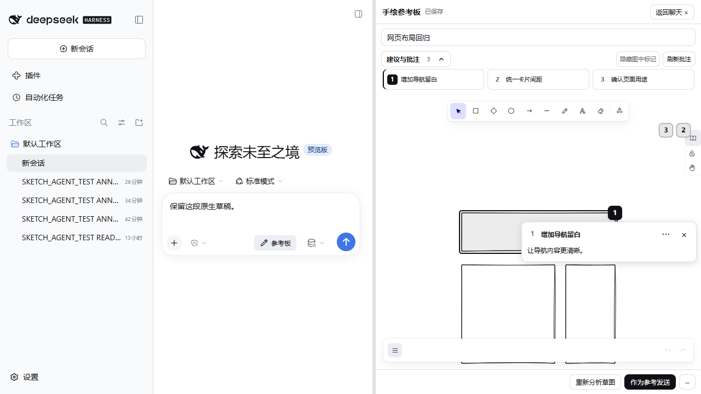
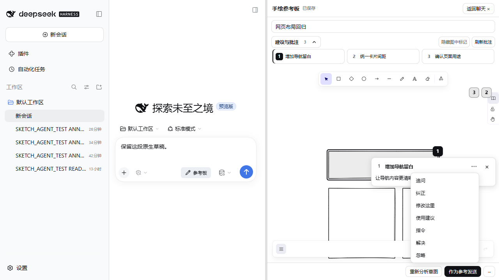
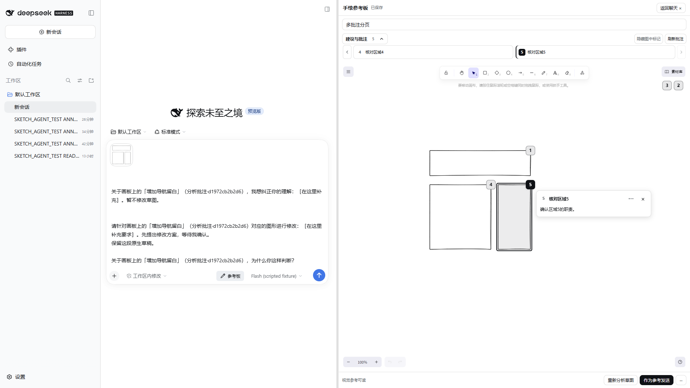

# 0.6.2 验证记录

基线：`2439eb7892f04077b8c6bddb8e4c36040aed3bc6`（main，0.6.1）。验证日期：2026-10-11。固定宿主 DSH 0.2.1-alpha.1、Excalidraw 0.18.1；没有升级依赖。

## 实际改动

顶部摘要、标题卡正文和画布详情原先重复同一信息。本版顶部只保留标题与必要的失效/处理状态；正文在画布详情显示一次。追问、纠正、修改、使用建议及状态操作集中在详情右上角的 SVG「⋯」菜单。刷新批注位于展开入口同一行的右侧。菜单复用浏览器原生 Popover 的顶层显示、点外关闭和 Esc 收起，样式采用现有宿主主题变量，不引入菜单依赖或另建聊天界面。

标记使用直立系统字体的数字圆角标签，选中实色、未选中浅色。每条未忽略的批注保留编号，含全局、已删除和视野外目标；后者保留边缘入口供点击定位。位置计算、高亮和定位继续使用 Excalidraw 的 `getCommonBounds`、`sceneCoordsToViewportCoords`、`scrollToContent` 与原有覆盖层。全局批注及已删除元素的说明也能在画布详情查看，缺失锚点仍不能进入讨论或修改。

独立分析允许零条结果，分析与 Agent 批注均取消三条数量上限；标题区每组显示三个，超过三个时显示左右箭头。点击画板编号自动切到对应标题。Agent 没有值得添加的批注时不调用工具。保留原有 2048 Token 输出预算和 16 KiB 分析响应边界，Agent 批注输入增加 64 KiB 字节保护，不以无限条目扩大载荷。旧数据仍可读取，旧批次前三条的稳定 ID 不变，长批次的 UUID 与索引保持一一对应。提示允许询问无标签区域、提出有依据的不确定解释；含义明确时才允许不提供建议，不将画得整齐误认为语义清楚。模型判断仍可能出错，此修改不是确定性语义分类器。

新增本机视角偏好，仅存储 zoom、scrollX、scrollY，以完整会话身份隔离，在关闭或页面隐藏时写入。它不进入场景、草图摘要、Agent 数据、撤销历史或 revision；损坏、存储被拒绝或配额不足时回退默认视角，不阻止草图保存和关闭。

README 增加 MIT → DSH → DeepWiki 徽章。没有修改宿主聊天、附件管理、SSE 协议或编辑白名单。

## 自动检查

- `pnpm run typecheck`：通过。
- `pnpm test`：20 个文件、184 项通过。基线实际为 19 个文件、174 项；保留原有测试，新增零建议解析/持久化/旧批注拒绝、长批次 UUID 与索引、第五条同标题批注精确引用、输入字节边界与视角隔离、损坏/权限失败覆盖。既有四条拒绝用例按新契约改为四条接受，继续验证空输入、超长输入与非法字段被拒绝。
- `pnpm run bundle`：通过。Windows 系统临时目录曾发生 esbuild EPERM，改用项目内测试临时目录后通过；未修改生产运行逻辑。保留既有 tsdown/Radix 提示和 Excalidraw 大分块警告。
- `pnpm pack`：通过。703 个条目，15,986,880 字节；含 MIT、第三方声明和本版用户文档，不含测试、AGENTS.md、开发环境和凭据。
- 包 SHA-256：`b40f47f6a4e5a7635ad21583c7a4b3646ebea75502178160e0a32f6800e02b70`。

## 安装后浏览器验证

使用真实 Windows Edge、真实 DSH 和 Excalidraw，专用无凭据 profile 的模型响应固定。以下是 UI/契约回归，不是对 DeepSeek 理解质量的打分。原始数值见 [browser-report.json](assets/v0.6.2/browser-report.json)。

`tests/browser-comment-polish.mjs` 已通过：

- 1280×720 与 1920×1080：正文仅一次、顶部无讨论按钮，刷新与展开入口同一行右对齐。示例短正文卡片实测宽 320px、高 74px，菜单入口 26×24px；不宣称所有长度的卡片都具有此高度。
- 菜单默认关闭，展开后只有一组操作；Esc、点击外部和再次点击入口均可关闭。标题 Enter/Space、悬停高亮、编号联动、隐藏/显示标记均通过。
- 三条时没有翻页按钮，五条时按 3+2 显示，五个编号全部保留；编号点击联动正确页面。视野外入口点击能回到目标，翻页/定位不保存或请求模型。选中/未选中背景与文字颜色不同，标题卡没有外扩焦点框。
- 解决、重新打开、忽略、显示已忽略后恢复；全局建议与删除锚点说明正常，删除目标的讨论操作禁用。
- 真实 PNG 作为待发送附件，分别执行追问、纠正和修改入口：原有草稿与附件保留，未自动发送，没有新增原生 Agent 请求。
- 单纯切换、悬停、菜单操作不增加 drawing/save、模型调用和 PNG 导出；revision 保持不变。
- 固定的零建议响应正常保存、关闭重开及重新加载，不生成虚假卡片或标记。此例专门检查空结果协议，不代表无标签方框应被模型判为无需讨论。
- 65% 缩放、scrollX=37、scrollY=-89 关闭重开完全恢复；新会话为默认视角，回到原会话恢复自己的视角。平移/缩放不增加草图保存或图片导出。
- 深浅主题切换正常；最终关闭后活跃批注 SSE 为 0，无 pageerror。

`tests/browser-agent.mjs` 已通过安装后的原生 Agent 循环回归（固定模型）：锚点/全局/同元素多批注、独立分析与 Agent 批次区分、状态保存、失败刷新保留未确认写入、丢失 ACK 幂等重试、乱序读取保护、三次 SSE 手动恢复、关闭后读取、过期批注、多会话隔离、失败/取消保留草图及 PNG 导出/原生输入桥。仅一次显式独立分析，没有真实模型请求。最终菜单、标题选中样式和完整编号/翻页修改后已执行以上两套回归。

调试期间发现并纠正了测试设施的默认工作区路径不匹配、启动日志尚未就绪、同版本本地 tarball 被 pnpm 缓存、动态 iframe 导航/检查脚本安装时序等问题；没有将这些失败计为插件测试通过。菜单入口早期的文字竖排来自 CSS 优先级冲突，最终改为纯 SVG 三点，并增加尺寸与图标结构断言。

### 当前实际 DSH 环境

已更新原有 AppContainer 隔离环境并重启宿主。复用原有“版本化安装包解压 + profile junction”的安装方式，保留旧包可回退；官方 CLI 安装另在无凭据测试 profile 验证。升级前后草图、Agent 批注和视觉存储三个文件 SHA-256 一致；源码只读、正式仓库禁止写入及测试状态可写的启动探针仍通过。通过 Codex 浏览器确认原有网页草图和两条批注可读取，新标题、右侧刷新、SVG 数字及更多菜单正常；未发送新模型消息。

## 界面证据

以下为固定响应的合成回归场景，无真实用户私人会话。

## 限制与发布边界

本轮没有真实 DeepSeek 对照实验，因此不能宣称模型批注质量或 Token 用量改善了某个百分比。旧批注内容不被静默重写，需要用户再次分析或在聊天中纠正。视角只在同一浏览器本机恢复，清除浏览器存储或异常崩溃可能丢失未写出的视角；草图保存机制不变。

Popover 已在当前 Windows Edge 和 Codex Chromium 验证，其他浏览器未覆盖。本轮没有重复全量应用生成、长期压力、全部编辑形状或移动端验收；未运行本机不存在的 CodeRabbit。附件自动回收、上游 MALFORMED_RESPONSE、模型误读以及同步断线需手动恢复等既有边界未在本版解决。

建议作为 0.6.2 待审查补丁。PR 合并、tag 与正式 Release 仍由维护者决定；此文档不代表已正式发布。
